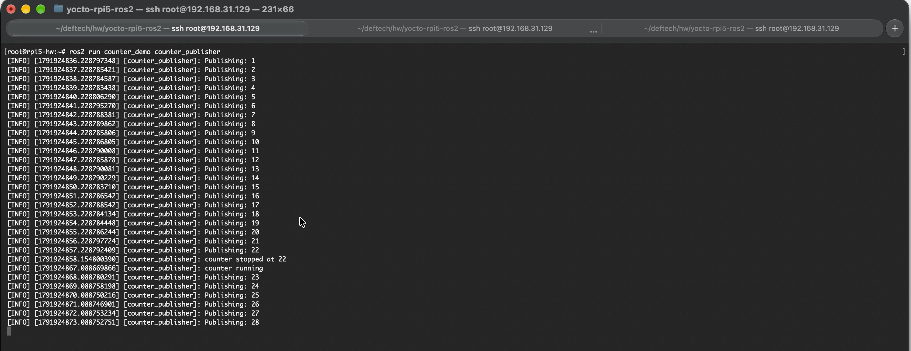
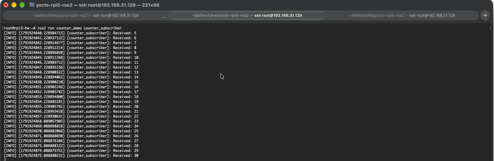
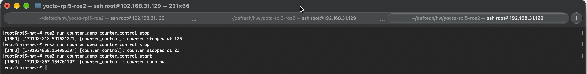
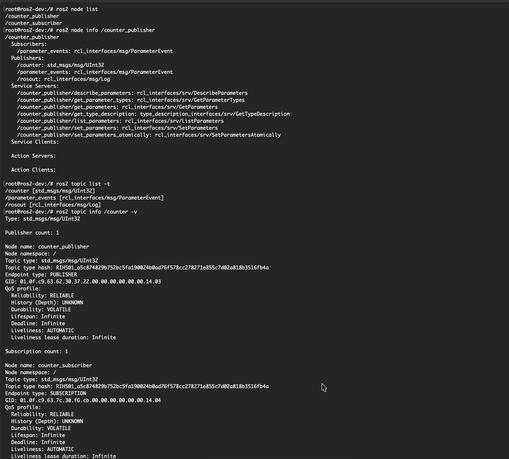
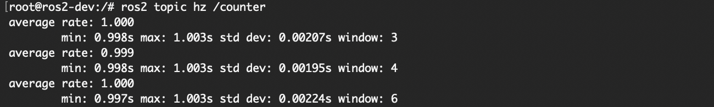

# yocto-rpi5-ros2

A Yocto image for the Raspberry Pi 5 with ROS 2 Jazzy. Two nodes pass a counter 1, 2, 3… over a topic, and a third one starts and stops it through a service.

It extends my `yocto-rpi5-wifi-ssh` layer: the board still joins Wi-Fi on boot and takes SSH logins, and ROS 2 comes on top through a separate layer, `meta-own-ros`.

Tested on a Raspberry Pi 5 Rev 1.1 (BCM2712 D0): Poky 5.0.21 (Scarthgap), kernel 6.6.63, ROS 2 Jazzy with Fast DDS 2.14.6. The compressed image is 124 MB, about 335 MB once unpacked.

## The nodes

| Node | What it does |
|---|---|
| `counter_publisher` | publishes 1, 2, 3… on `/counter` (`std_msgs/msg/UInt32`) once a second and serves `/counter/enable` (`std_srvs/srv/SetBool`): `true` resumes the counter, `false` stops it |
| `counter_subscriber` | prints every value it gets from `/counter` |
| `counter_control` | takes `start` or `stop` and calls `/counter/enable` once |

Stopping cancels the publisher's timer and keeps the value, so after `start` the count goes on from where it stopped. All three are C++ (`rclcpp`) in one package, `counter_demo`.

## What's inside

```
layers/                      git submodules, all on scarthgap:
                             poky, meta-raspberrypi, meta-openembedded, meta-ros
meta-own/                    Wi-Fi, Dropbear SSH, build-time secrets (from yocto-rpi5-wifi-ssh)
meta-own-ros/                the ROS 2 layer
  recipes-ros/counter-demo/    builds ros2_ws/src/counter_demo
  recipes-ros/ros-env/         sources /opt/ros/jazzy/setup.sh in login shells
  recipes-core/dev-shm/        mounts tmpfs on /dev/shm for Fast DDS
  recipes-core/images/         own-ros-image: own-image + ROS 2 + the nodes
  conf/templates/default/      local.conf and bblayers.conf for this build
ros2_ws/src/counter_demo/    the ROS 2 package
docs/                        screenshots from the board
release.conf                 switches the build to the demo secrets
secrets.env.example          variables the build needs
```

On top of `own-image`, `own-ros-image` installs `ros-core` with the `ros2` command line tool, `demo-nodes-cpp` for the official talker and listener, and the recipes from `meta-own-ros`.

## Build

You need a Linux host supported by Yocto 5.0, for example Ubuntu 24.04, with the [host packages](https://docs.yoctoproject.org/scarthgap/ref-manual/system-requirements.html#ubuntu-and-debian) and the `en_US.UTF-8` locale. I built it on a MacBook with Apple Silicon in an arm64 `ubuntu:24.04` container.

Clone with the submodules:

```sh
git clone --recurse-submodules https://github.com/vmihda/yocto-rpi5-ros2.git
```

The container gets the repository at `/project` and a volume for everything heavy at `/work`. BitBake needs user namespaces, and Docker's default seccomp profile blocks them, hence `seccomp=unconfined`:

```sh
docker volume create yocto-work
docker run -it --name yocto-ros --hostname yocto-ros \
  --security-opt seccomp=unconfined \
  -v yocto-work:/work \
  -v "$PWD/yocto-rpi5-ros2":/project \
  ubuntu:24.04 bash
```

Install the host packages inside, then work as a regular user (BitBake refuses to run as root):

```sh
# Secrets live outside the repository
cp /project/secrets.env.example /work/rpi5-secrets.env
chmod 600 /work/rpi5-secrets.env
$EDITOR /work/rpi5-secrets.env

# Create the build directory from the saved template and build
TEMPLATECONF=/project/meta-own-ros/conf/templates/default \
  source /project/layers/poky/oe-init-build-env /work/build-ros
bitbake own-ros-image
```

The template points `DL_DIR` and `SSTATE_DIR` at `/work/build/downloads` and `/work/build/sstate-cache`, which I share with my earlier build without ROS. Change them in `conf/local.conf` if your layout differs.

Put your own public key in `meta-own/recipes-core/ssh-authorized-keys/files/authorized_keys` before building. The one in the repo is mine.

The result is `tmp/deploy/images/raspberrypi5/own-ros-image-raspberrypi5.rootfs.wic.bz2`.

### Memory and disk

The build dir took 15 GB, downloads 9 GB, the sstate cache 9.4 GB (the last two include the build without ROS).

With 10 GB of RAM, no swap and 8 CPUs, the build died in `rust-llvm-native` with `Killed signal terminated program cc1plus`: by default BitBake runs 8 tasks with 8 compiler jobs each. I added 3 GB of swap in Docker Desktop and these lines at the end of `conf/local.conf`:

```
BB_NUMBER_THREADS = "4"
PARALLEL_MAKE = "-j 4"
```

They depend on the machine, so they are not in the template.

## Flash and connect

On macOS:

```sh
diskutil list external
diskutil unmountDisk /dev/diskN
bzcat own-ros-image-raspberrypi5.rootfs.wic.bz2 | sudo dd of=/dev/rdiskN bs=4m status=progress
diskutil eject /dev/diskN
```

On Linux, `bmaptool copy` with the `.wic.bmap` file next to the image writes only the blocks that hold data.

The board sends the hostname `rpi5-hw` over DHCP on `wlan0`, and on `eth0` if a cable is plugged in. Every reflash generates a new Dropbear host key, so run `ssh-keygen -R <board-ip>` first:

```sh
ssh root@<board-ip>
```

## Run on the board

The ROS environment is already loaded after login. One SSH session per node:

```sh
ros2 run counter_demo counter_publisher
```

```sh
ros2 run counter_demo counter_subscriber
```

```sh
ros2 run counter_demo counter_control stop
ros2 run counter_demo counter_control start
```

The publisher stops at 22 and goes on with 23 after `start`:



The subscriber joined when the count was already at 5, and since the topic is `VOLATILE`, it never sees 1 to 4. Between 22 and 23 it gets nothing:





The same checks with the ROS 2 tools:

```sh
ros2 node list
ros2 node info /counter_publisher
ros2 topic list -t
ros2 topic info /counter -v
ros2 topic hz /counter
ros2 service call /counter/enable std_srvs/srv/SetBool "{data: false}"
ros2 pkg prefix counter_demo      # /opt/ros/jazzy, so it came with the image
```

`ros2 run demo_nodes_cpp talker` and `listener` work too.

## Develop on a host

The package builds with `colcon` against ROS 2 Jazzy on Ubuntu 24.04. I used a second container with Jazzy from the [ROS apt repository](https://docs.ros.org/en/jazzy/Installation/Ubuntu-Install-Debs.html) (`ros-jazzy-ros-base`, `ros-dev-tools`):

```sh
cd /project/ros2_ws
colcon build
source install/setup.bash
ros2 run counter_demo counter_publisher
```


With the publisher and the subscriber running in the container, the ROS 2 tools see both nodes on `/counter` with matching QoS: `RELIABLE` and `VOLATILE` on both sides. `History (Depth): UNKNOWN` is expected, because the queue depth is a local setting that discovery doesn't carry.



The timer fires once a second:



## Demo image in Releases

The image in Releases is not the one I use myself. Mine has my Wi-Fi PSK and root password hash inside. The demo one is built from the same tree with another secrets file:

```sh
bitbake -R /project/release.conf own-ros-image
```

`release.conf` only changes `RPI5_SECRETS`, and BitBake reads it after `local.conf`.

In the demo image Wi-Fi is not configured, so use Ethernet. Log in as `root` with the password `ros2-demo` and change it with `passwd`. To use Wi-Fi, edit `/etc/wpa_supplicant.conf` and run `ifdown wlan0; ifup wlan0`.

Check the download against `SHA256SUMS` from the release:

```sh
shasum -a 256 -c SHA256SUMS
```

## Notes on this build

### DISTRO stays poky

meta-ros's own configuration for the Pi 5 sets `DISTRO = "ros2"`. That distro switches to systemd and connman, and my Wi-Fi setup from `meta-own` would stop working: it is built on sysvinit, ifupdown and the wpa_supplicant hook. The ROS version doesn't depend on the distro: `meta-ros2-jazzy/conf/layer.conf` sets `ROS2_DISTRO = "jazzy"` by itself. So I kept `DISTRO = "poky"` and only added the layers. `bitbake -e own-ros-image` shows `DISTRO="poky"` and `VIRTUAL-RUNTIME_init_manager="sysvinit"`.

Layers on top of poky and meta-raspberrypi: `meta-oe` and `meta-python` from meta-openembedded, then `meta-ros-common`, `meta-ros2` and `meta-ros2-jazzy` from meta-ros. That is all `ros-core` and the demo nodes need. The upstream kas files also add Qt, clang and others for packages this image doesn't use.

### The counter-demo recipe

The recipe follows the generated meta-ros recipes (`inherit ros_distro_jazzy`, `ros_ament_cmake`), but takes the sources from `ros2_ws/src` in this repository instead of a git URL:

```
FILESEXTRAPATHS:prepend := "${THISDIR}/../../../ros2_ws/src:"
SRC_URI = "file://counter_demo"
```

BitBake checksums the files, so editing a `.cpp` rebuilds the package without any cleanup.

### /dev/shm

At first `counter_control` printed `[RTPS_TRANSPORT_SHM Error] Failed init_port ... open_and_lock_file failed` before its reply. The reply still came, because Fast DDS fell back to UDP. Fast DDS moves data between local processes through `/dev/shm`, and on this image it was only a plain directory: poky with sysvinit doesn't mount a tmpfs there.

An `fstab` entry would not help. `mountall.sh` runs at S03, and udev creates `/dev/shm` at S04, so the mount point doesn't exist yet when `mount -a` runs, and `mountall.sh` hides the error with `2>/dev/null`. The `dev-shm` recipe adds an init script at S05 that mounts the tmpfs right after udev. `mount | grep /dev/shm` on the board shows it.

### Why Rust gets built

I didn't expect a Rust compiler in a ROS build. `ros-core` depends on `sros2` (ROS 2 security), which needs `python3-cryptography`, and cryptography 42 has a Rust core. So the build compiles `rust-native` and its own LLVM once, and that is where it ran out of memory.

### sstate from the non-ROS build

I pinned poky and meta-raspberrypi to the same commits as my previous build, hoping to reuse its sstate. Most target packages were rebuilt anyway. meta-ros enables Fortran in gcc (`meta-ros-common/conf/ros-distro/include/enable-fortran.inc`), which changes the cross compiler and everything built with it. Native tools and downloads were reused.

### The board is not visible from Docker on the Mac

DDS discovery uses multicast, which doesn't cross Docker Desktop's NAT, and the container advertises an address the board can't reach. So I ran every check on the board itself.

## References

- [meta-ros](https://github.com/ros/meta-ros), scarthgap branch; [kas configs](https://github.com/ros/meta-ros/tree/build/kas) in the `build` branch
- [ROS 2 Jazzy documentation](https://docs.ros.org/en/jazzy/)
- [REP 2000](https://reps.openrobotics.org/rep-2000/), supported platforms per ROS 2 release
- [Yocto Project 5.0 documentation](https://docs.yoctoproject.org/scarthgap/)
- [meta-raspberrypi, scarthgap branch](https://github.com/agherzan/meta-raspberrypi/tree/scarthgap)
- [yocto-rpi5-wifi-ssh](https://github.com/vmihda/yocto-rpi5-wifi-ssh), the image this one builds on
